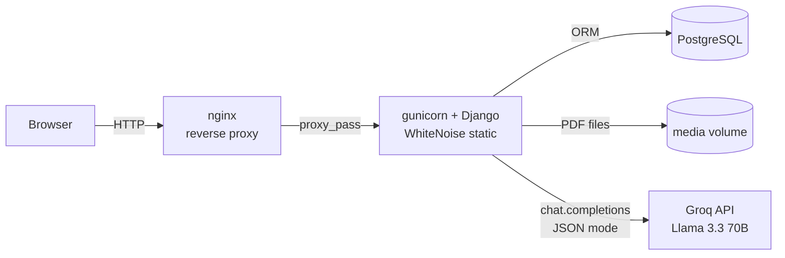
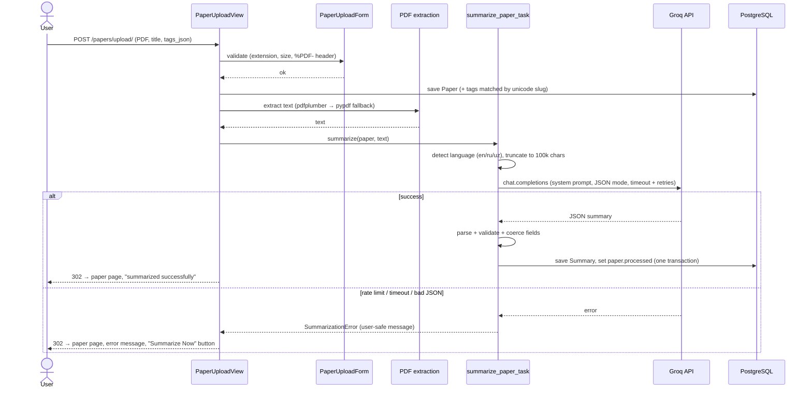

# Academic Summarizer

**Upload an academic PDF, get a structured five-section summary in seconds.** A Django app that extracts text from research papers, sends it to a Groq-hosted LLM in JSON mode and stores the result as Abstract, Key Points, Methodology, Results and Conclusion, plus the paper's key references. Summaries can be exported to PDF/Word or shared through expiring links.

[](https://github.com/samandar-hamrayev/Academic-Summarizer/actions/workflows/ci.yml)


[](LICENSE)

<!--
  Screenshot / demo placeholder. Add an image to docs/ and reference it here, e.g.
  
-->

---

## Why

Reading a 20-page paper just to decide whether it is relevant takes time. Students and
researchers mostly need the same five things from every paper: what it contributes, how it
was done, what it found, what it concludes and which works it builds on. This app pulls those
out automatically and keeps them searchable, exportable and shareable — in English, Russian
or Uzbek.

## Features

- **PDF upload** with drag and drop, extension + size + `%PDF-` magic-byte validation (50 MB by default).
- **Text extraction** with `pdfplumber`, falling back to `pypdf` for PDFs pdfplumber can't read.
- **Structured AI summary** in one Groq call using JSON mode: abstract, key points, methodology, results, conclusion and up to 10 citations.
- **Multilingual**: detects English / Russian / Uzbek (Cyrillic) from character statistics and uses a prompt in that language.
- **AI tag suggestions** before upload; you confirm or edit them, and they become filterable tags.
- **Exports** to PDF (ReportLab, Cyrillic-capable font in Docker) and Word (python-docx).
- **Share links** with 1/7/30-day or no expiry, revocation and an access counter; expired links return `410 Gone`.
- **Accounts and isolation**: registration, login, and every query scoped to the owner. Uploaded PDFs are only served through an owner-checked download view, never as public media.
- **History, search and tag filters** for your papers, plus the Django admin.
- **Graceful failures**: rate limits, timeouts and API errors become clear messages. The paper is kept, and you can re-run summarization later.
- **Production-ready setup**: Docker (non-root, health checks), PostgreSQL, nginx, gunicorn, WhiteNoise, GitHub Actions CI.

## Architecture



**Upload and summarize flow** (`papers/views.py` → `papers/services.py` → `summarizer/services.py`):



## Design decisions

| Decision | Why |
|---|---|
| **Groq + JSON mode** (`response_format={"type": "json_object"}`) | Groq's fast inference keeps a synchronous request practical. JSON mode stops the model from returning prose or unquoted values, and a tolerant parser still strips code fences and fixes field types. |
| **Model ID from `GROQ_MODEL`** | Groq retires models (for example `llama-3.1-70b-versatile`). Making the ID configurable means a retirement needs an env change, not a code change. Default: `llama-3.3-70b-versatile`. |
| **One `SummarizationError` type** | The views show its message to users as is. Raw SDK exceptions are logged but never shown, so internals don't leak. |
| **LLM call outside the DB transaction** | The slow network call happens first. The Summary and the `processed` flag are then written atomically, so no transaction stays open while we wait for Groq. |
| **Synchronous summarization, gunicorn `gthread` workers** | Avoids running a Celery + Redis stack for a short operation. Threads let one worker keep serving other requests while a summary is in flight. Timeouts are chained: `GROQ_TIMEOUT × (retries+1)` < gunicorn < nginx. |
| **Private PDFs via an owner-checked download view** | Paths like `papers/user_<id>/<name>` are guessable, so `/media/` is never exposed by Django or nginx. |
| **State-changing actions are POST + CSRF** | Re-summarize (which costs an LLM call), creating and revoking share links were GET links before. They are now CSRF-protected forms. |
| **Unicode-aware tag slugs** | `slugify("Нейросети")` returned `""`, so the second Cyrillic tag broke the unique constraint. Tags are now matched by a `allow_unicode` slug, which also removes duplicates like "Deep Learning" and "deep learning". |
| **Static files baked into the image, served by WhiteNoise** | No shared volume between containers. Files get hashed names with far-future cache headers and are pre-compressed. |
| **Config only from environment** | `DEBUG` defaults to off, and `SECRET_KEY` is required unless `DEBUG` is on. HTTPS hardening and proxy-header trust are opt-in, so one image runs locally and in production. |

## Tech stack

| Layer | Technology |
|---|---|
| Language / framework | Python 3.12, Django 5.2 |
| LLM | Groq API (`groq` SDK), Llama 3.3 70B by default |
| PDF parsing | pdfplumber, pypdf |
| Exports | ReportLab (PDF), python-docx (Word) |
| Database | PostgreSQL 16 (Docker/CI), SQLite fallback for local dev |
| Serving | gunicorn (gthread), nginx, WhiteNoise |
| Frontend | Django templates, Bootstrap 5, vanilla JS (drag and drop, tag preview, dark mode) |
| Quality | pytest, pytest-django, pytest-cov, ruff, pre-commit, gitleaks |
| Ops | Docker multi-stage build, Docker Compose, GitHub Actions, Dependabot |

## Quick start

You need a free Groq API key from <https://console.groq.com/keys>.

### Docker (PostgreSQL + gunicorn + nginx)

```bash
git clone https://github.com/samandar-hamrayev/Academic-Summarizer.git
cd Academic-Summarizer
cp .env.example .env
# Edit .env and set at least SECRET_KEY, POSTGRES_PASSWORD and GROQ_API_KEY
make up            # docker compose up -d --wait  (builds, migrates, waits for health checks)
make superuser     # optional: create an admin account
```

Open <http://localhost:18180> (the `HTTP_PORT` in `.env`) and register an account.
`make logs`, `make down` and `make clean` (which also deletes volumes) manage the stack.

### Local (no Docker)

```bash
python3.12 -m venv .venv && source .venv/bin/activate
make install                     # runtime + dev deps, pre-commit hooks
cp .env.example .env             # set DEBUG=True and GROQ_API_KEY; leave DATABASE_URL empty for SQLite
make run                         # migrate + runserver on http://127.0.0.1:8000
```

## Configuration

All settings come from environment variables (a local `.env` is loaded automatically).
See [`.env.example`](.env.example).

| Variable | Default | Description |
|---|---|---|
| `SECRET_KEY` | — (required unless `DEBUG`) | Django secret key. |
| `DEBUG` | `False` | Debug mode; never enable in production. |
| `ALLOWED_HOSTS` | `localhost 127.0.0.1` | Comma/space-separated hostnames. |
| `CSRF_TRUSTED_ORIGINS` | empty | Full origins allowed to POST, e.g. `https://summarizer.example.com`. |
| `TRUST_PROXY_HEADERS` | `False` | Trust `X-Forwarded-Host/Proto` (set to `True` by docker-compose behind nginx). |
| `SECURE_COOKIES` | `False` | Secure session/CSRF cookies (enable with HTTPS). |
| `SECURE_SSL_REDIRECT` | `False` | Redirect HTTP to HTTPS. |
| `SECURE_HSTS_SECONDS` | `0` | HSTS max-age. |
| `LOG_LEVEL` | `INFO` | Root log level. |
| `DATABASE_URL` | SQLite file | Any `dj-database-url` URL. Compose builds it from `POSTGRES_*`. |
| `DB_CONN_MAX_AGE` | `600` | Persistent DB connection lifetime (seconds). |
| `POSTGRES_DB` / `POSTGRES_USER` / `POSTGRES_PASSWORD` | `academic_summarizer` / `django` / — | PostgreSQL credentials for Compose (password is required). |
| `GROQ_API_KEY` | — | Groq API key. Without it, uploads still work but summarization reports a clear error. |
| `GROQ_MODEL` | `llama-3.3-70b-versatile` | Any [Groq chat model](https://console.groq.com/docs/models). |
| `GROQ_TIMEOUT` | `45` | Per-request timeout (seconds). |
| `GROQ_MAX_RETRIES` | `2` | SDK retries for connection errors, 429 and 5xx. |
| `MAX_UPLOAD_MB` | `50` | Maximum PDF size (keep nginx `client_max_body_size` above it). |
| `HTTP_PORT` | `8080` (`18180` in the example) | Host port nginx is published on (bound to 127.0.0.1). |
| `GUNICORN_WORKERS` / `GUNICORN_THREADS` / `GUNICORN_TIMEOUT` | `3` / `4` / `180` | gunicorn tuning (see `gunicorn.conf.py`). |
| `RUN_MIGRATIONS` | `1` | Run `migrate` on container start. |

## Routes

| Method | Path | Auth | Description |
|---|---|---|---|
| GET | `/` | – | Landing page |
| GET/POST | `/auth/register/`, `/auth/login/` | – | Sign up / sign in |
| POST | `/auth/logout/` | ✓ | Sign out |
| GET | `/papers/?query=` | ✓ | Your papers, searchable by title/author |
| GET/POST | `/papers/upload/` | ✓ | Upload a PDF; extracts, summarizes and tags it |
| GET | `/papers/tag/<slug>/` | ✓ | Your papers with a tag |
| GET | `/papers/<id>/` | owner | Paper details and summary preview |
| GET | `/papers/<id>/download/` | owner | Original PDF |
| POST | `/papers/<id>/summarize/` | owner | Re-run summarization |
| GET/POST | `/papers/<id>/delete/` | owner | Delete paper, summary and stored file |
| POST | `/summarizer/preview-tags/` | ✓ | JSON: AI tag suggestions for a PDF (not saved) |
| GET | `/summarizer/history/` | ✓ | All your summaries |
| GET | `/summarizer/<id>/` | owner | Full summary with share-link management |
| GET | `/summarizer/<id>/export/pdf/`, `/export/word/` | owner | Download as PDF / DOCX |
| POST | `/summarizer/<id>/share/` | owner | Create share link (`expiry_days`: 0 = never, max 365) |
| POST | `/summarizer/share/revoke/<link_id>/` | owner | Revoke a share link |
| GET | `/summarizer/shared/<uuid>/` | public | Read-only shared summary (`410` if expired/revoked) |
| GET | `/healthz/` | public | JSON health check including a DB query (`503` if the DB is down) |
| GET | `/admin/` | staff | Django admin |

"owner" means other users get a `404`, which doesn't reveal that the object exists.

## Testing

```bash
make test     # pytest
make cov      # with coverage report
make lint     # ruff check + ruff format --check
make check    # lint + tests, same as CI
```

The suite has **108 tests at about 97% coverage** and runs fully offline. The Groq client is mocked, and test
PDFs are generated with ReportLab. It covers:

- PDF extraction and the fallback path, plus upload validation
- Groq integration: model and JSON-mode arguments, language prompts, every API error path, and response-parsing edge cases
- Views: auth, upload success and failure, ownership checks on every object route
- Exports: markup escaping, unicode filenames
- Share links and the health check

CI runs the tests against PostgreSQL 16, matching production.

## Project structure

```
Academic-Summarizer/
├── academic_summarizer/     # Project config: settings (env-driven), urls, /healthz/ view
├── papers/                  # Upload, storage, PDF extraction, tags, auth views
│   ├── services.py          #   PDF validation + text extraction (pdfplumber → pypdf)
│   ├── signals.py           #   delete stored PDF when a Paper is deleted
│   └── views.py             #   list/search, upload, detail, download, delete, re-summarize
├── summarizer/              # LLM summarization, history, sharing, exports
│   ├── services.py          #   Groq client, prompts (en/ru/uz), JSON parsing, tag extraction
│   ├── exports.py           #   PDF (ReportLab) and DOCX (python-docx) rendering
│   └── views.py             #   summary pages, share links, exports, tag preview API
├── templates/ static/       # Bootstrap 5 UI, drag-and-drop upload, dark mode
├── tests/                   # pytest suite + isolated test settings
├── nginx/nginx.conf         # Reverse proxy config
├── Dockerfile               # Multi-stage, non-root, HEALTHCHECK
├── docker-compose.yml       # db + web + nginx with health-gated startup
├── docker-compose.dev.yml   # runserver + hot reload
├── gunicorn.conf.py         # Env-driven gunicorn settings
├── .github/                 # CI workflow + Dependabot
└── pyproject.toml           # ruff, pytest and coverage config
```

## Roadmap

- [ ] Move summarization to a background worker (Celery/RQ) with progress polling, for very long papers.
- [ ] Chunked map-reduce summarization for papers longer than the 100k-character input cap.
- [ ] Per-user rate limiting on the summarize and tag-preview endpoints.
- [ ] Object storage (S3-compatible) for uploaded PDFs.
- [ ] REST API (Django REST Framework) for programmatic access.
- [ ] OCR fallback for scanned PDFs without a text layer.

## License

[MIT](LICENSE) © 2026 Samandar Hamrayev
